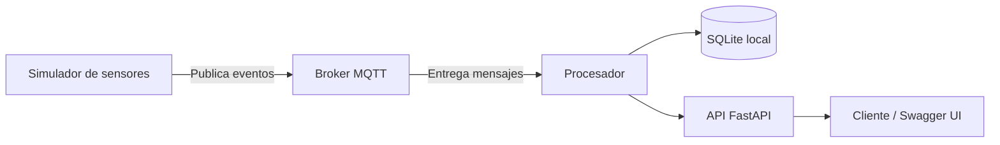

# 🚗 Estacionamiento Inteligente IoT con Microservicios

   

Proyecto académico de **Evaluación Solemne: Sistema IoT con Microservicios**. Simula la operación de un estacionamiento inteligente mediante eventos de sensores, mensajería MQTT, procesamiento desacoplado y una API REST.

> **Alcance de esta versión:** ejecución local con Docker, simulación de eventos, comunicación MQTT, procesamiento y API FastAPI. Se contempla persistencia local con SQLite. **No se incluye una conexión operativa a Firebase Firestore ni un despliegue en Vercel.**

## 🎯 Objetivo

Diseñar un sistema IoT modular que permita simular cambios de ocupación de espacios de estacionamiento, transmitir eventos y consultar información procesada a través de una API.

## 🧩 Arquitectura



> Diagrama conceptual. La comunicación exacta entre procesador, base de datos y API depende de la implementación del repositorio.

## 🛠️ Tecnologías

| Tecnología | Función |
| --- | --- |
| Python | Lógica del simulador y servicios |
| MQTT | Transporte de eventos IoT |
| Broker MQTT | Distribución de mensajes entre servicios |
| FastAPI | Exposición de endpoints HTTP |
| SQLite | Almacenamiento local |
| Docker y Docker Compose | Ejecución y orquestación de contenedores |
| Firebase Firestore | Integración futura; no conectada en esta fase |
| Vercel | Despliegue futuro; no implementado en esta fase |

## ✅ Funcionalidades de la Fase 3B

- Simulación de eventos asociados a sensores de estacionamiento.
- Publicación y consumo de mensajes mediante MQTT.
- Procesamiento de los eventos recibidos.
- Ejecución de los servicios en contenedores Docker.
- Consulta de la API REST y su documentación interactiva FastAPI.
- Preparación o utilización de almacenamiento SQLite local, según la configuración del proyecto.
- Configuración prevista para integración futura con servicios en la nube.

## 📋 Requisitos

- Git.
- Docker Desktop con Docker Compose habilitado.
- Un navegador web para consultar la documentación de la API.
- Visual Studio Code (opcional).

## 🚀 Instalación y ejecución local

### 1. Clonar el repositorio

```bash
git clone <URL_DEL_REPOSITORIO>
cd <CARPETA_DEL_PROYECTO>
```

Reemplaza los valores entre `<>` por la URL y el nombre reales.

### 2. Revisar la configuración

Ubica el archivo `compose.yaml` o `docker-compose.yml`. Si el repositorio incluye un archivo `.env.example`, cópialo a `.env` y completa únicamente las variables necesarias.

**Importante:** no subas contraseñas, tokens, claves privadas ni credenciales de Firebase al repositorio.

### 3. Levantar los contenedores

Desde la carpeta donde se encuentra el archivo Compose:

```bash
docker compose up --build -d
```

### 4. Comprobar el estado

```bash
docker compose ps
```

Para consultar los registros:

```bash
docker compose logs -f
```

Para consultar solo algunos servicios, usa los nombres reales mostrados por `docker compose config --services`:

```bash
docker compose config --services
```

### 5. Consultar FastAPI

Si la API publica el puerto `8000` en el equipo anfitrión, abre:

- Documentación Swagger: http://localhost:8000/docs
- Esquema OpenAPI: http://localhost:8000/openapi.json

Si el puerto publicado es otro, reemplaza `8000` por el que indique Docker Compose. Los endpoints disponibles se muestran en Swagger y son la fuente de referencia para esta versión.

### 6. Detener el sistema

```bash
docker compose down
```

Evita `docker compose down -v` si deseas conservar los volúmenes de datos.

## 🧪 Verificación de funcionamiento

1. Comprueba que los contenedores requeridos estén en ejecución con `docker compose ps`.
2. Revisa los logs del simulador y del procesador; verifica que se publiquen y consuman mensajes MQTT.
3. Abre `/docs` y ejecuta una solicitud a uno de los endpoints existentes.
4. Si SQLite está habilitado, comprueba que los registros persistan según la configuración local.
5. Si la API expone un campo `cloud_configured`, un valor `false` es esperable mientras Firestore no esté configurado.

## 🗂️ Estructura del proyecto

La estructura exacta de carpetas y los nombres de servicios deben consultarse en el repositorio. Los componentes lógicos principales son:

```text
Estacionamiento Inteligente
├── Simulador IoT
├── Broker MQTT
├── Procesador de eventos
├── API REST (FastAPI)
├── Persistencia SQLite local
└── Configuración Docker Compose
```

Este esquema **no representa nombres literales de directorios**.

## ☁️ Integraciones pendientes

### Firebase Firestore

La base de datos en Firebase puede estar creada, pero **esta versión no acredita una conexión funcional** desde los microservicios. La sincronización con la nube y la gestión segura de credenciales quedan pendientes.

### Vercel

**No existe despliegue en Vercel para esta fase.** La aplicación se ejecuta localmente mediante Docker.

## 🧯 Solución de problemas

**Error `no configuration file provided: not found`**

Ejecuta Docker Compose desde el directorio que contiene el archivo Compose, o indica su ruta explícitamente:

```bash
docker compose -f ruta/al/compose.yaml ps
```

**La API no responde:** revisa `docker compose ps`, los logs del servicio API y el mapeo de puertos en Compose.

**No aparecen mensajes MQTT:** verifica los logs del broker, simulador y procesador; comprueba que compartan la red y configuración MQTT correctas.

**Los datos desaparecen al reiniciar:** revisa dónde se guarda SQLite y si su archivo está montado en un volumen persistente.

## 🔜 Próximos pasos

- Completar y verificar la conexión con Firebase Firestore.
- Validar la sincronización de datos locales y remotos.
- Incorporar pruebas automatizadas y manejo de errores.
- Evaluar opciones de despliegue remoto, incluido Vercel si corresponde a la arquitectura.
- Documentar los endpoints definitivos y agregar capturas de evidencia.

---

**Versión documentada:** Fase 3B — ejecución local, sin Firestore operativo ni despliegue en Vercel.
