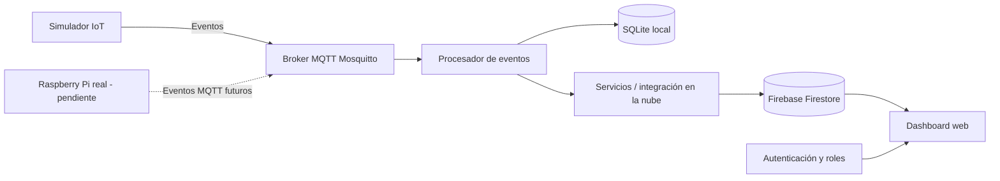

# 🚗 Estacionamiento Inteligente IoT con Microservicios

**Evaluación Solemne — Sistema IoT con Microservicios**

[](https://github.com/CTorrejon1995/PTEC104-8571-S1-ESTACIONAMIENTO-INTELIGENTE)
[](https://github.com/CTorrejon1995/PTEC104-8571-S1-ESTACIONAMIENTO-INTELIGENTE)

Sistema de estacionamiento inteligente basado en una arquitectura IoT de microservicios. Permite simular eventos de ocupación, transmitirlos mediante MQTT, procesarlos y consultar la información desde una API y un dashboard web conectado a Firebase Firestore.

> **Estado actual (octubre de 2026):** el software, el dashboard, la integración con Firestore, el despliegue en Vercel y el control de acceso por roles `admin` y `viewer` están implementados y funcionando. **La única integración pendiente es reemplazar o complementar el simulador con una Raspberry Pi física.**

## 🌐 Aplicación web

**[Abrir dashboard desplegado en Vercel](https://ptec-104-8571-s1-estacionamiento-in-eta.vercel.app/)**

El acceso a las funciones depende del usuario autenticado y de su rol asignado.

## 🎯 Objetivo

Construir un sistema modular para registrar y visualizar eventos de ocupación de estacionamientos, separando la generación de eventos, la mensajería, el procesamiento, la persistencia y la interfaz web. La arquitectura permite comenzar con sensores simulados y posteriormente incorporar hardware real.

## 🏗️ Arquitectura general



> Esquema conceptual de los componentes del proyecto. Las rutas concretas de lectura y escritura entre servicios dependen de la configuración del código.

## 🧰 Tecnologías

| Tecnología | Uso |
|---|---|
| Python | Simulador y lógica de servicios |
| MQTT / Eclipse Mosquitto | Mensajería de eventos IoT |
| FastAPI | API REST |
| SQLite | Persistencia local |
| Firebase Firestore | Almacenamiento e integración de datos en la nube |
| Docker y Docker Compose | Contenedores y orquestación local |
| Vercel | Despliegue de la aplicación web |
| Dashboard web | Visualización y administración según permisos |
| Raspberry Pi | Dispositivo físico por integrar |

## 📂 Estructura del repositorio

```text
PTEC104-8571-S1-ESTACIONAMIENTO-INTELIGENTE/
├── api/                 # API local
├── cloud-api/           # Servicios de integración en la nube
├── mosquitto/           # Configuración del broker MQTT
├── processor/           # Procesamiento de eventos
├── simulator/           # Simulación de sensores IoT
├── web/                 # Aplicación web / dashboard
├── .env.example         # Ejemplo de variables de entorno
├── .gitignore
├── docker-compose.yml   # Orquestación de servicios
└── README.md
```

## ✅ Funcionalidades implementadas

- Simulación de eventos IoT de ocupación de estacionamiento.
- Publicación y consumo de mensajes mediante MQTT.
- Procesamiento desacoplado de eventos.
- Servicios locales organizados mediante Docker Compose.
- API REST basada en FastAPI.
- Persistencia local con SQLite.
- Integración funcional con Firebase Firestore.
- Dashboard web implementado y operativo.
- Aplicación desplegada en Vercel.
- Autenticación de usuarios y autorización según roles `admin` y `viewer`.
- Separación de funciones de administración y visualización.

### 🔐 Roles y permisos

| Funcionalidad | Admin | Viewer |
|---|---|---|
| Acceder al dashboard con sesión autorizada | ✅ | ✅ |
| Consultar información permitida | ✅ | ✅ |
| Acceder a funciones de administración | ✅ | ❌ |
| Gestionar funciones reservadas a administradores | ✅ | ❌ |

**Importante:** ocultar la interfaz de administración no sustituye las reglas de seguridad de Firestore ni la autorización en el servidor. Las restricciones deben mantenerse en la capa de datos y en los servicios correspondientes.

## 🚀 Instalación local

### 1. Requisitos

- Git
- Docker Desktop con Docker Compose
- Variables y credenciales necesarias para las integraciones utilizadas
- Navegador web

### 2. Clonar el proyecto

```bash
git clone https://github.com/CTorrejon1995/PTEC104-8571-S1-ESTACIONAMIENTO-INTELIGENTE.git
cd PTEC104-8571-S1-ESTACIONAMIENTO-INTELIGENTE
```

### 3. Configurar variables de entorno

Revisa `.env.example` y crea el archivo de configuración local según las variables que requiera tu entorno:

```bash
cp .env.example .env
```

Completa los valores necesarios sin publicar contraseñas, tokens, credenciales privadas ni claves de servicio. Las variables del despliegue en Vercel deben configurarse en el entorno correspondiente.

### 4. Iniciar los microservicios

```bash
docker compose up --build -d
```

Consultar servicios y registros:

```bash
docker compose ps
docker compose logs -f
```

Para identificar los servicios disponibles:

```bash
docker compose config --services
```

### 5. Consultar la API

Consulta los puertos publicados en `docker-compose.yml`. Si FastAPI está expuesta en el puerto 8000, su documentación interactiva estará en:

```text
http://localhost:8000/docs
```

La ruta y el puerto definitivos dependen de la configuración efectiva del servicio.

### 6. Detener los servicios

```bash
docker compose down
```

## 🧪 Comprobaciones del sistema

1. Confirmar que los contenedores se ejecutan correctamente.
2. Verificar que el simulador publique eventos MQTT y que el procesador los reciba.
3. Consultar la API y revisar la persistencia configurada.
4. Comprobar la visualización de datos en el dashboard.
5. Iniciar sesión con una cuenta `admin` y comprobar las funciones administrativas.
6. Iniciar sesión con una cuenta `viewer` y confirmar que no acceda a funciones administrativas.
7. Comprobar que las reglas de Firestore y los servicios rechazan las operaciones no autorizadas.
8. Verificar que el despliegue de Vercel funcione correctamente.

Las funcionalidades anteriores se reportan como operativas; las comprobaciones sirven como guía de reproducción y mantenimiento.

## 🔌 Único paso pendiente: Raspberry Pi real

El sistema funciona actualmente con simulación de sensores. Para completar la integración física se requiere:

1. Preparar la Raspberry Pi y conectar los sensores físicos previstos.
2. Implementar o adaptar la lectura de sensores en el dispositivo.
3. Configurar la conexión segura al broker MQTT.
4. Publicar eventos con el formato que espera el procesador existente.
5. Verificar que los eventos físicos lleguen al procesamiento, a la persistencia y al dashboard.
6. Comparar el funcionamiento real con los resultados obtenidos mediante el simulador.

**La Raspberry Pi todavía no se declara conectada ni probada.**

## 🔒 Consideraciones de seguridad

- Mantener las credenciales fuera del repositorio.
- Aplicar autorización por roles en Firestore y en los servicios que lo requieran.
- Evitar que un usuario `viewer` pueda elevar sus privilegios o modificar información restringida.
- Limitar el acceso a los recursos de la nube y a los endpoints según el principio de mínimo privilegio.
- Revisar las reglas de Firestore y las variables de entorno después de cualquier cambio.

## 📌 Estado del proyecto

| Componente | Estado |
|---|---|
| Simulador IoT | ✅ Implementado |
| Broker MQTT | ✅ Implementado |
| Procesador de eventos | ✅ Implementado |
| API REST | ✅ Implementada |
| SQLite | ✅ Implementado |
| Firebase Firestore | ✅ Operativo |
| Dashboard web | ✅ Operativo |
| Roles admin / viewer | ✅ Configurados y funcionando |
| Despliegue Vercel | ✅ Operativo |
| Raspberry Pi física | ⏳ Pendiente de integración |

## 🔗 Enlaces

- **Código fuente:** https://github.com/CTorrejon1995/PTEC104-8571-S1-ESTACIONAMIENTO-INTELIGENTE
- **Aplicación web:** https://ptec-104-8571-s1-estacionamiento-in-eta.vercel.app/

---

**Proyecto académico — Evaluación Solemne: Sistema IoT con Microservicios.**

**Estado:** implementación de software completada; pendiente únicamente la integración y prueba del hardware Raspberry Pi real.
