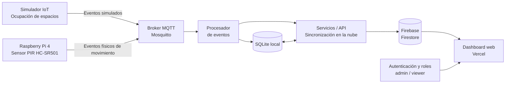

# Parking Smart — Estacionamiento Inteligente IoT con Microservicios

**Proyecto PTEC104-8571-S1 · Implementación finalizada · Octubre de 2026**

[](https://ptec-104-8571-s1-estacionamiento-in-eta.vercel.app/)
[](https://github.com/CTorrejon1995/PTEC104-8571-S1-ESTACIONAMIENTO-INTELIGENTE)

## Descripción

**Parking Smart** es una plataforma de monitoreo IoT para estacionamientos, desarrollada con una arquitectura de microservicios. Integra una **Raspberry Pi 4 con sensor PIR HC-SR501**, mensajería **MQTT**, procesamiento de eventos, persistencia **SQLite**, sincronización con **Firebase Firestore** y un **dashboard web desplegado en Vercel**.

El sistema distingue expresamente entre **eventos reales de movimiento** obtenidos por el PIR físico y **datos simulados de ocupación** de estacionamientos. El PIR detecta movimiento; **no mide distancias ni determina por sí solo si una plaza está ocupada**.

- **Repositorio:** https://github.com/CTorrejon1995/PTEC104-8571-S1-ESTACIONAMIENTO-INTELIGENTE
- **Dashboard:** https://ptec-104-8571-s1-estacionamiento-in-eta.vercel.app/

## Estado del proyecto

| Componente | Estado |
| --- | --- |
| Raspberry Pi 4 y sensor PIR HC-SR501 | Integrados; eventos físicos visibles en el dashboard |
| Publicación y procesamiento de eventos MQTT | Implementados |
| Microservicios Mosquitto, processor y API | Implementados con Docker Compose |
| API REST con FastAPI | Implementada |
| Persistencia local SQLite | Implementada |
| Sincronización con Firebase Firestore | Operativa |
| Dashboard en Vercel | Desplegado |
| Roles `admin` y `viewer` | Configurados y probados funcionalmente |
| Separación de datos físicos y simulados | Visible en el dashboard |
| Inicio automático del sensor PIR | Configurado mediante systemd |

> **Alcance:** El proyecto está finalizado según la implementación reportada. Las capturas muestran eventos físicos y simulados en el panel. El aviso «Sin actividad reciente» es compatible con un sensor que no ha detectado movimiento en el período considerado; no implica necesariamente una falla.

## Arquitectura general

La arquitectura se representa mediante un flujo de componentes conectados. El sensor PIR físico y el simulador publican eventos independientes en MQTT; el procesador los registra localmente y la integración con la nube permite visualizarlos en el dashboard.



**Alcance del hardware:** La solución integra una Raspberry Pi 4 con un sensor PIR HC-SR501, de acuerdo con el alcance autorizado para el proyecto. El PIR detecta movimiento, no ocupación de plazas; la ocupación de los espacios virtuales se obtiene del simulador y se presenta separadamente en el dashboard.

## Tecnologías

| Capa | Tecnología | Función |
| --- | --- | --- |
| Hardware | Raspberry Pi 4, HC-SR501 | Detección física de movimiento |
| Mensajería | MQTT, Eclipse Mosquitto | Transporte de eventos |
| Procesamiento | Python, Docker Compose | Ejecución de microservicios |
| Backend | FastAPI | API REST |
| Almacenamiento local | SQLite | Persistencia de eventos |
| Nube | Firebase Firestore | Datos sincronizados para la plataforma |
| Frontend | Dashboard web, Vercel | Visualización y administración |
| Arranque automático | systemd, Docker | Inicio al encender la Raspberry Pi |

## Funcionalidades del dashboard

### Sensor físico Raspberry Pi 4

El panel muestra la última detección del sensor **PIR de entrada**, el número de movimientos observados, el origen físico de los eventos y un historial de detecciones como **«Movimiento detectado»** y **«Movimiento finalizado»**. La señal se obtiene del sensor **HC-SR501 conectado a GPIO17** y se identifica con el tópico:

```text
parking/pir/pir-entrada-01/event
```

### Estacionamientos simulados

El panel ofrece una demostración independiente de ocupación, con plazas identificadas como `P01` a `P08`, estados **Libre/Ocupado**, distancias simuladas, indicadores agregados y actividad reciente. **Estas distancias y estados no son mediciones del PIR físico.**

### Control de acceso

- **`admin`:** acceso al monitoreo y a las funciones de administración autorizadas.
- **`viewer`:** acceso de consulta al dashboard, sin mostrar la sección de Administración.

Los roles están configurados y han sido probados funcionalmente. Para mantener la protección, las restricciones deben aplicarse también en las reglas de Firestore y no únicamente en la interfaz.

## Puesta en marcha con Docker Compose

Clonar el repositorio:

```bash
git clone https://github.com/CTorrejon1995/PTEC104-8571-S1-ESTACIONAMIENTO-INTELIGENTE.git
cd PTEC104-8571-S1-ESTACIONAMIENTO-INTELIGENTE
```

### Configuración del archivo `.env`

**Antes de iniciar los contenedores, hay que crear el archivo `.env`.** El repositorio incluye un archivo `.env.example` que sirve de **plantilla**: muestra el formato y los nombres de las variables esperadas, pero no reemplaza el archivo `.env` de cada instalación.

En la carpeta donde se encuentre `.env.example`, ejecutar:

```bash
cp .env.example .env
nano .env
```

En Windows se puede copiar el archivo manualmente y renombrar la copia a `.env`.

**¿Qué va en cada archivo?**

| Archivo | Para qué sirve | ¿Se sube a GitHub? |
| --- | --- | --- |
| `.env.example` | Plantilla con los nombres de las variables y valores de ejemplo **sin secretos reales**. | Sí |
| `.env` | Configuración efectiva de la instalación: direcciones, puertos, identificadores y credenciales según lo que pida la plantilla. | **No** |
| `compose.yaml` / `docker-compose.yml` | Define los contenedores y puede leer variables del `.env`. | Sí, sin contraseñas incrustadas |
| Credenciales privadas de Firebase, si las utiliza el backend | Archivo de cuenta de servicio o secreto configurado mediante variable de entorno, según la implementación. | **No** |

Al editar `.env`, **conservar exactamente los nombres de las variables** de `.env.example` y reemplazar solamente los valores que correspondan. Como referencia:

- **MQTT:** dirección del broker, puerto y autenticación *si la plantilla los solicita*. Si los contenedores están en la misma red de Compose, normalmente se usa el nombre del servicio como host; el script PIR ejecutado en la Raspberry fuera de Docker puede necesitar `localhost` o la IP del equipo.
- **API y base local:** direcciones, puertos o rutas de almacenamiento, cuando estén definidos como variables.
- **Firebase/Firestore:** identificadores de proyecto y configuración de sincronización; cualquier credencial privada debe mantenerse fuera del repositorio.
- **Frontend/Vercel:** las variables que necesite el despliegue web se configuran también en los ajustes del proyecto de Vercel. Las variables expuestas al navegador no deben contener secretos de servidor.

> **Importante:** estos son grupos de configuración orientativos, **no nombres literales de variables**. Los nombres exactos y cuáles son obligatorias dependen del `.env.example` del repositorio. No agregar variables inventadas ni publicar claves reales en capturas o commits.

Verificar que `.env` esté excluido del control de versiones (por ejemplo, en `.gitignore`) y comprobar la configuración de Compose antes de arrancar:

```bash
docker compose config --quiet
```

Este comando comprueba la configuración de Compose, pero **no valida** que las credenciales externas sean correctas. **No subir claves privadas, archivos `.env` ni credenciales de servicio a GitHub.**

Desde el directorio que contiene el archivo Compose correspondiente:

```bash
docker compose up -d --build
docker compose ps
docker compose logs -f
```

Los servicios **`mosquitto`**, **`processor`** y **`api`** deben tener la política de reinicio:

```yaml
restart: unless-stopped
```

Habilitar Docker en el arranque:

```bash
sudo systemctl enable --now docker
```

> Los nombres exactos de archivos Compose, rutas y variables deben revisarse en la instalación clonada.

## Arranque automático de Raspberry Pi 4

El sistema utiliza **Docker Compose** para los microservicios y **systemd** para iniciar automáticamente el programa que lee el sensor PIR real. El simulador se ejecuta **manualmente**, evitando mezclar su operación con el arranque del hardware físico.

### 1. Crear el servicio

```bash
sudo nano /etc/systemd/system/parking-pir.service
```

Contenido utilizado en la Raspberry Pi del proyecto:

```ini
[Unit]
Description=Sensor PIR - Estacionamiento Inteligente
Wants=network-online.target
After=network-online.target docker.service

[Service]
Type=simple
User=chris
WorkingDirectory=/home/chris/parking-iot/raspberry
ExecStart=/usr/bin/python3 -u /home/chris/parking-iot/raspberry/estacionamientoF_mqtt.py
Restart=always
RestartSec=5

[Install]
WantedBy=multi-user.target
```

**Importante:** adaptar `User`, `WorkingDirectory` y `ExecStart` a la cuenta y ubicación reales del proyecto. Comprobar que Python tenga instaladas las dependencias del script y que el usuario pueda acceder al GPIO.

### 2. Activar el servicio

```bash
sudo systemctl daemon-reload
sudo systemctl enable --now parking-pir
```

### 3. Verificar su funcionamiento

```bash
sudo systemctl status parking-pir
journalctl -u parking-pir -f
```

Para comprobar los contenedores:

```bash
docker compose ps
```

### 4. Prueba después de reiniciar

```bash
sudo reboot
```

Tras reconectarse a la Raspberry Pi:

```bash
systemctl is-enabled parking-pir
systemctl is-active parking-pir
sudo systemctl status docker
docker compose ps
```

Generar movimiento delante del PIR y verificar que el dashboard registre eventos físicos nuevos. Si no aparecen, revisar los logs del servicio, la conexión MQTT y la sincronización con Firestore.

## Comprobación de sincronización

Cuando la API local esté disponible en el puerto configurado para el proyecto (por ejemplo, `8000`), el estado de sincronización se puede consultar mediante:

```bash
curl -s http://127.0.0.1:8000/parking/sync-status | python3 -m json.tool
```

La respuesta informa el total de eventos, los eventos pendientes y si la nube está configurada. Una cola pendiente puede causar retrasos entre la detección y su aparición en el dashboard.

## Evidencia funcional

Las capturas de la implementación final muestran:

- Eventos del sensor físico Raspberry Pi 4, con origen de datos identificado como **Sensor físico**.
- Actividad de detección y finalización de movimiento.
- Panel de estacionamientos simulados separado de las lecturas del PIR.
- Ocho plazas simuladas, con estados y métricas agregadas.
- Sesión `viewer` con navegación de monitoreo y sin acceso visible a Administración.

Los valores observados en las capturas son ejemplos puntuales y cambian conforme se generan nuevos eventos.

## Consideraciones de seguridad

- Mantener las credenciales de Firebase y las claves privadas fuera del repositorio.
- Aplicar permisos `admin` y `viewer` en las reglas de seguridad de Firestore, además del frontend.
- Evitar escrituras de eventos o modificaciones de roles desde cuentas sin autorización.
- Verificar que usuarios no autenticados no puedan leer datos privados.
- No exponer el broker MQTT ni la API local innecesariamente a Internet.
- Revisar periódicamente registros de Docker, systemd y sincronización.

## Conclusión

**Parking Smart** integra hardware físico, servicios desacoplados, mensajería MQTT, persistencia local, sincronización en la nube y una interfaz web con perfiles diferenciados. La Raspberry Pi 4 publica eventos reales del PIR, mientras el simulador permite demostrar la ocupación de plazas sin atribuir esas mediciones al sensor físico.

El proyecto se presenta como **implementación finalizada**, con arranque automático del sensor y los microservicios, dashboard operativo y separación explícita entre telemetría física y datos de simulación.

---

**Proyecto académico:** PTEC104-8571-S1 — Estacionamiento Inteligente IoT con Microservicios.
